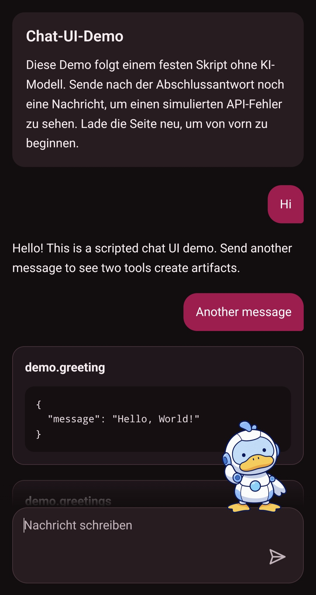

# AI Service

Bring agent conversations into your application with a shared execution service and a reusable chat UI.

## Features

- **Agent conversations:** run multi-turn conversations with live responses and tool progress.
- **Structured artifacts:** present agent results using JSON cards or your application's custom renderers.
- **Reusable chat UI:** embed the Angular chat component with optional session and connection handling.
- **Connected tools:** the Kochwiki agent combines model responses with domain tools supplied through MCP.
- **Scripted demo:** explore the UI, artifacts, and error states without model credentials.

## Documentation

See the [documentation overview](docs/README.md) for domain terminology, code navigation, development, operation, and architectural decisions.
