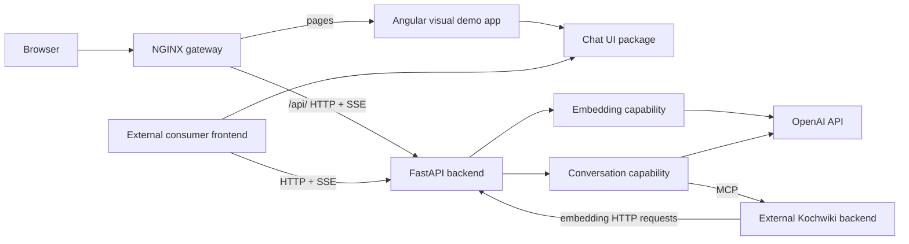

# Repository navigation

The conversation capability combines backend execution with a reusable Angular chat UI. The Visual Demo illustrates integration; the Kochwiki configuration connects execution to external domain tools.

## System overview

The [gateway](../deployment/gateway/nginx.conf) serves the visual demo and API. The visual demo (`visual-demo`) uses a deterministic local model without external credentials; the Kochwiki agent uses OpenAI and external MCP tools. Sessions live in backend memory and do not survive restarts.

## Code map

| Area | Responsibilities and starting points |
| --- | --- |
| [Application](../backend/app/main.py) | FastAPI assembly, router registration, and shared [HTTP error handling](../backend/app/core/http.py). |
| [Application lifespan](../backend/app/lifespan.py) | Starts and stops capabilities and demos. Loads shared [provider settings](../backend/app/core/config.py); the conversation lifecycle loads [conversation settings](../backend/app/capabilities/conversations/config.py). |
| [Session API](../backend/app/capabilities/conversations/http.py) | Session creation, reads, prompt admission, and SSE observation under `/api/v1/agents/{configuration}/sessions`. [Presentation](../backend/app/capabilities/conversations/presentation.py) projects native history into public snapshots. |
| [Embeddings](../backend/app/capabilities/embeddings/) | Embedding endpoint and provider integration. See [usage and profiles](domains/embeddings.md). |
| [Execution](../backend/app/capabilities/conversations/runner.py) | Owns background turns. [Registry](../backend/app/capabilities/conversations/sessions.py) handles ownership and expiry; [session state](../backend/app/capabilities/conversations/session_state.py) retains conversation, lifecycle, and artifacts. |
| [Agent composition](../backend/app/capabilities/conversations/wiring.py) | Configures the Kochwiki model and MCP connection. [Turns](../backend/app/capabilities/conversations/turns.py) execute through Pydantic AI; [artifacts](../backend/app/capabilities/conversations/artifacts.py) validate and publish presentation data. |
| [Chat UI package](../frontend/projects/chat-ui/) | `@roithme0/chat-ui/ui` renders host-supplied content; `@roithme0/chat-ui/conversation` supplies the [controller](../frontend/projects/chat-ui/conversation/src/session-controller.ts), HTTP/SSE transport, and snapshot mapping. |
| [Visual Demo](../backend/app/demos/visual_conversation_demo/) | Scripted conversation with messages, artifacts, simulated delays, and error states. The [visual page](../frontend/src/app/pages/visual-demo/visual-demo.component.ts) hosts its chat UI at `/demos/visual`; the [landing page](../frontend/src/app/pages/demo-landing/demo-landing.component.ts) at `/` selects demos. |
| [Deployment](../deployment/) | Environment-specific Compose definitions and gateway routing. The [publishing workflow](../.github/workflows/publish-app.yml) builds and publishes application images and the chat UI package. |

The [contract generator](../frontend/scripts/conversation-contract.mjs) produces [TypeScript types and Zod schemas](../frontend/projects/chat-ui/conversation/generated/) from the session router's OpenAPI document.

## Follow a flow

- **Send a prompt:** the controller calls the [transport](../frontend/projects/chat-ui/conversation/src/session-transport.ts) → session API → runner → session state → Pydantic AI. HTTP 202 acknowledges admission; execution continues in the background.
- **Display progress:** the runner streams complete snapshots over SSE → controller → [presentation mapper](../frontend/projects/chat-ui/conversation/src/session-presentation.ts) → [chat component](../frontend/projects/chat-ui/ui/lib/components/chat-ui/chat-ui.component.ts). Backend snapshots supply conversation content and execution status.
- **Present an artifact:** the consumer advertises supported schemas at session creation → the agent calls `present_artifact` → validation and session retention → snapshot → consumer renderer. Publication does not save domain data; domain operations belong to MCP tools.

## Find related tests

- Conversations: [backend/tests/capabilities/conversations/](../backend/tests/capabilities/conversations/), covering session state, execution, HTTP/SSE, artifacts, agent wiring, and conversation resource lifecycle.
- Embeddings: [backend/tests/capabilities/embeddings/](../backend/tests/capabilities/embeddings/).
- Application: [test_lifespan.py](../backend/tests/test_lifespan.py) covers startup and shutdown across capabilities and demos; [test_capability_integration.py](../backend/tests/test_capability_integration.py) covers capability independence. Application HTTP and shared infrastructure tests also live under [backend/tests/](../backend/tests/).
- Demos: [backend/tests/demos/](../backend/tests/demos/), with Visual Demo execution and lifecycle tests under `visual_conversation_demo/`.
- Frontend: `*.spec.ts` beside application and library code; tooling checks in [frontend/scripts/](../frontend/scripts/).
- Deployment: [deployment/tests/](../deployment/tests/), with backend and gateway test runners.
